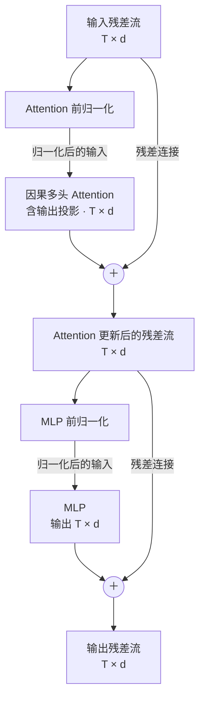

# 残差流

> 状态：草稿

> 前置内容：[残差连接与归一化](../04_transformer/06_residual_and_layernorm.md)、[Multi-Head Attention](../04_transformer/03_multi_head_attention.md)。

本篇要回答：残差流是什么，为什么能把不同子层的计算连接起来，又能怎样用于分析和干预模型？

## 1. 残差流

**残差流（residual stream）是沿网络深度传递、由各子层通过加法共同更新的隐藏状态。** 输入嵌入给出初始状态，Attention 和 MLP 依次读取当前状态，将各自算出的更新加回其中。一次残差连接对应计算图中的一次加法。沿着这些加法追踪状态，就能看见不同层如何通过同一表示传递信息。[Elhage 等，2021，Transformer Overview](https://transformer-circuits.pub/2021/framework/index.html)

省略 batch 维度，长度为 $T$ 的序列在每个观察点都有一个 $T\times d$ 的残差状态，第 $t$ 行对应该 token 位置的 $d$ 维向量。沿深度看，这一行累积各层的更新。沿序列看，因果 Attention 可以把先前位置的信息写入这一行，MLP 则逐位置更新。给定整个 block 边界的状态，就给定了后续网络在所有位置的输入。

## 2. 计算图中的残差流

以 GPT-2 的串行 Pre-Norm decoder block 为例，记第 $\ell$ 个 block 的输入为 $R_\ell\in\mathbb R^{T\times d}$。两次残差更新依次发生。[Radford 等，2019，第 2.3 节](https://cdn.openai.com/better-language-models/language_models_are_unsupervised_multitask_learners.pdf)

```math
\begin{aligned}
R'_\ell &= R_\ell + \mathrm{Attn}_\ell(\mathrm{Norm}_{\ell,a}(R_\ell)),\\
R_{\ell+1} &= R'_\ell + \mathrm{MLP}_\ell(\mathrm{Norm}_{\ell,m}(R'_\ell)).
\end{aligned}
```

其中，下标 $a$ 和 $m$ 分别标记 Attention 与 MLP 子层前的归一化。Attention 项包含其输出投影，两项输出都与残差流同形状，为 $T\times d$。

计算图用节点表示中间量或运算，用箭头表示数据传递。图中三个残差状态依次对应层输入 $R_\ell$、Attention 更新后的 $R'_\ell$ 和层输出 $R_{\ell+1}$。两条残差连接分别绕过 Attention 和 MLP。



设模型有 $n$ 个 block，进入第一个 block 的初始表示为 $R_1$。逐层展开上述递推式，第 $\ell$ 个 block 的输出为：

```math
\begin{aligned}
R_{\ell+1}
&=R_1
+\sum_{i=1}^{\ell}\mathrm{Attn}_i\!\left(\mathrm{Norm}_{i,a}(R_i)\right)\\
&\quad+\sum_{i=1}^{\ell}\mathrm{MLP}_i\!\left(\mathrm{Norm}_{i,m}(R_i')\right),
\qquad 1\leq\ell\leq n.
\end{aligned}
```

对一次给定的前向，当前状态等于初始嵌入与此前所有写入之和，宽度始终为 $d$。每项写入的数值又取决于此前的状态，例如第 $\ell$ 层的 MLP 读取的是 Attention 更新后的 $R'_\ell$。若要分别查看每项写入，可以在两处加法前各保存一次子层输出。最后一个 block 给出 $R_{n+1}$，模型随后对它做最终归一化和词表投影。

观察残差流时，应区分子层更新前、更新后，以及归一化后的输入。它们位于计算图的不同位置，代表不同的中间量。Post-Norm 或并行 Attention / MLP 架构的观察点需按其前向计算确定。

## 3. 一次写入怎样影响后续层

Attention 将不同位置的 value 汇集到目标位置，再经输出投影写回。MLP 根据该位置的激活值组合写入向量。两种更新都落在同一个 $d$ 维空间，所以早期写入可以成为更深层的输入。[Attention 各 head 的输出投影](../04_transformer/03_multi_head_attention.md#2-并行计算与输出投影)、[MLP 的矩阵定义](../04_transformer/05_mlp.md#1-逐位置前馈计算)

一次写入能传递什么，取决于后续模块读取哪个方向。设 $r$ 是一个位置的残差行向量， $\Delta r$ 是本次写入， $W$ 是后续模块的读取矩阵。仅考虑线性投影时，两项按下式相加。

```math
(r+\Delta r)W=rW+\Delta rW.
```

这次写入对该投影的直接贡献是 $\Delta rW$。若它为零，另一个读取矩阵仍可能读到这次写入。实际的 Pre-Norm 子层读取 $\mathrm{Norm}(r+\Delta r)W$，还要考虑归一化统计量的变化。

*Talking Heads* 给出了跨层读取的例子。在 GPT-2 small 的名字选择任务中，早期 head 向残差流写入抑制特定名字的信号，后续 head 通过 query 读取该信号，改变它关注的位置。作者结合权重分解和路径干预检验了这些特定 head 之间的通信。[Merullo 等，2024，第 2—5 节](https://arxiv.org/html/2406.09519)

后续层也能抵消此前的写入。Janiak 等在四层模型 GELU-4L 中观察到，早期 head L0H2 写入后，更深层的若干 head 沿相反方向写回。阻断 L0H2 通往这些 head 的 value 输入的路径后，抵消明显减弱。一个方向即使在最终残差中很弱，也可能在较早的层被读取过。[Janiak 等，2024，第 2—3 节](https://aclanthology.org/2024.blackboxnlp-1.15/)

## 4. 怎样观察和干预残差流

研究一个具体行为时，先选定层、token 位置和子层更新前后的观察点。例如，Shai 等在已知生成过程的序列上，从多个层的残差向量中读出了模型对隐藏状态的估计。同样是观察中间表示，若问题换成“哪个词的分数更高”，就应使用词表读取器。[预测状态的探针实验](./probing_representations.md#受控序列中的预测状态)、[Logit Lens](./logit_lens.md)

| 研究问题 | 在选定观察点做什么 |
| --- | --- |
| 表示里有哪些候选特征？ | 收集残差向量，拟合稀疏重建并检查特征。[Superposition 与 SAE](./superposition_and_sae.md) |
| 哪一层、哪一位置的信息会影响预测？ | 替换该处的残差状态，重新运行下游网络并比较目标分数。[Activation Patching 与下游重算](./activation_patching.md#替换后为什么要重算下游) |
| 沿某个方向写入能否改变行为？ | 将引导向量加到残差流，测量输出随强度的变化。[Activation Steering](./steering_and_editing.md) |
